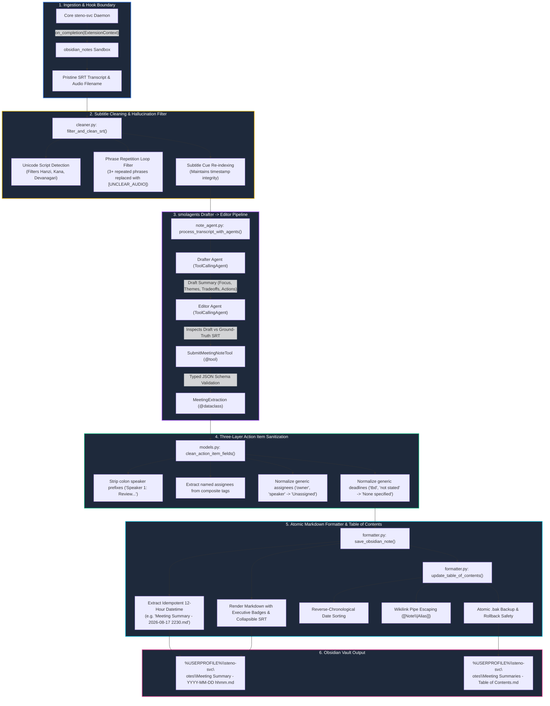

# Obsidian Meeting Notes Generator (`obsidian_notes`) — Features & Capabilities Reference

Comprehensive reference of all system features, multi-agent pipeline stages, subtitle cleaning filters, and formatting mechanisms in the **`obsidian_notes`** extension for **`steno-svc`**.

---

## 1. System Overview & Architecture Pipeline

The `obsidian_notes` extension is a fully isolated, read-only post-processing extension for `steno-svc`. It consumes pristine SRT transcripts generated by the local Steno ASR engine, cleans transcription artifacts, orchestrates a two-agent Hugging Face `smolagents` pipeline (Drafter $\rightarrow$ Editor), validates structured data via typed `@dataclass` tool submission, and publishes executive-grade meeting summaries directly to an Obsidian vault.



---

## 2. Multi-Agent Note Synthesis Pipeline

### Hugging Face `smolagents` Integration

- Employs Hugging Face `smolagents.ToolCallingAgent` powered by `OpenAIServerModel`.
- Compatible with OpenAI (`gpt-4o`, `gpt-4o-mini`, `gpt-5.6-terra`, `o1`, `o3`), local Ollama (`llama3.2`, `qwen2.5-coder`), vLLM, and OpenRouter endpoints.

### Two-Step Drafter $\rightarrow$ Editor Pipeline

1. **Drafter Agent (`note_agent.py`)**:
    - Analyzes cleaned transcript cues.
    - Synthesizes an initial structured draft containing meeting title, date/time, executive focus, key topics/themes, architectural tradeoffs, and concrete action items.
    - Operates with an exploratory temperature and comprehensive prompting to capture all technical discussions.
2. **Editor Agent (`note_agent.py`)**:
    - Cross-examines the Drafter's synthesis against the source SRT subtitles.
    - Eliminates hallucinated facts, figures, and phantom attendees.
    - Verifies technical metrics (latency, memory thresholds, error codes) against the exact transcript text.
    - Polishes tone and clarity for executive presentation.

### Deterministic Typed Tool Submission (`SubmitMeetingNoteTool`)

- Eliminates fragile regex parsing of markdown blocks.
- The Editor agent invokes a typed custom tool:
    ```python
    submit_meeting_note(
        title="...",
        meeting_datetime="...",
        executive_focus="...",
        thematic_sections=[...],
        tradeoffs_decisions=[...],
        action_items=[...]
    )
    ```
- Inputs are dynamically parsed into typed standard-library `@dataclass` structures (`MeetingExtraction`, `ThematicSection`, `ActionItem`, `TradeoffDecision`), guaranteeing schema validation at invocation time.

---

## 3. Subtitle Cleaning & Foreign Hallucination Defense

Whisper models occasionally hallucinate foreign script or loop phrases during long silences or ambient noise. The extension cleans raw SRT content prior to sending it to the LLM:

### Unicode Script Filter

- Detects non-Latin hallucinated scripts common in Whisper ASR when processing background noise or non-verbal vocalizations:
    - Chinese Hanzi (`\u4e00-\u9fff`)
    - Japanese Hiragana and Katakana (`\u3040-\u30ff`)
    - Devanagari and Sanskrit (`\u0900-\u097f`)
- Replaces hallucinated blocks with `[UNCLEAR_AUDIO]` markers while preserving legitimate surrounding cues.

### Repetition Loop Suppression

- Detects verbatim 3+ phrase repetition loops (e.g. `"Thank you for watching. Thank you for watching. Thank you for watching."`).
- Removes redundant cue sequences, preventing token budget exhaustion and agent distraction.

### Subtitle Cue Re-indexing

- Sequentially re-numbers cue IDs (`1, 2, 3, ...`) after filtering invalid blocks.
- Preserves accurate millisecond time boundaries (`HH:MM:SS,mmm --> HH:MM:SS,mmm`) for ground-truth verification.

---

## 4. Three-Layer Action Item Sanitization

To ensure action items remain crisp, actionable, and executive-ready even when meeting audio lacks diarization, the extension enforces a three-layer guarantee:

```
[Layer 1: Schema Rule]     --> SubmitMeetingNoteTool parameter docstring forbids speaker labels
          │
[Layer 2: Agent Prompt]    --> System prompt penalizes "Unidentified speaker" placeholders
          │
[Layer 3: Runtime Regex]   --> clean_action_item_fields() normalizes and sanitizes strings
```

### Runtime Defensive Sanitizer (`clean_action_item_fields`)

- **Strips Speaker Colon Prefixes**:
    - Input: `"Speaker 1: Review deployment configurations"`
    - Output: `"Review deployment configurations"`
- **Extracts Named Assignees from Composite Tags**:
    - Input: Assignee: `"Platform Engineer (assignment); unidentified speaker (follow-up)"`
    - Output: Assignee: `"Platform Engineer"`, Task: normalized
- **Normalizes Generic Assignees**:
    - Maps `"owner"`, `"speaker"`, `"team"`, `"none"`, `"unidentified speaker"` $\rightarrow$ `"Unassigned"`.
- **Normalizes Generic Deadlines**:
    - Maps `"not stated"`, `"tbd"`, `"none"`, `"asap"`, `"n/a"` $\rightarrow$ `"None specified"`.

---

## 5. Idempotent 12-Hour Datetime Naming

### Deterministic Filename Generation

- File names strictly follow the template:
  `Meeting Summary - YYYY-MM-DD hhmm.md`
  _(e.g., `Meeting Summary - 2026-08-17 2230.md`)_
- Extracted directly from audio recording filenames:
    - Samsung Voice Recorder format: `Voice 260817_223026.m4a` $\rightarrow$ `2026-08-17 2230`
    - ISO format: `2026-08-17_22-30-26.wav` $\rightarrow$ `2026-08-17 2230`
    - Fallback to current system timestamp if audio filename lacks recognizable datetime patterns.

### Zero AI-Title Drift

- Note filenames are decoupled from LLM-generated titles.
- Re-running distillation on the same audio updates the note in-place without generating duplicate files (`Meeting Summary - Topic A.md`, `Meeting Summary - Topic B.md`) in your vault.

---

## 6. Atomic Table of Contents (`Meeting Summaries - Table of Contents.md`)

The extension automatically creates and maintains a centralized index in the Obsidian vault:

- **Reverse-Chronological Ordering**: Notes are sorted chronologically from newest meeting to oldest.
- **Wikilink Pipe Escaping**: Obsidian links in markdown tables are escaped (`[[Meeting Summary - 2026-08-17 2230\|Meeting Title — Executive Summary]]`), ensuring table columns do not break.
- **In-Place Row Updates**: If a note already exists in the table, its row is updated rather than appended as a duplicate.
- **Transactional Atomic Writes**:
    - Before writing, an existing Table of Contents is copied to a temporary `.bak` backup file.
    - If a disk write error occurs, the previous file is restored immediately.
    - The `.bak` file is safely deleted upon successful completion.

---

## 7. Configuration Hierarchy & Secret Isolation

The extension operates with a 3-tier configuration hierarchy:

| Priority    | Tier              | File / Mechanism                     | Description                                                                       |
| ----------- | ----------------- | ------------------------------------ | --------------------------------------------------------------------------------- |
| 1 (Lowest)  | In-Code Defaults  | `default_config()` in `extension.py` | Safe fallback settings (`gpt-5.6-terra`, default vault path).                     |
| 2 (Middle)  | Tracked Template  | `config.json`                        | Version-controlled template containing safe keys with empty credentials.          |
| 3 (Highest) | Secured Overrides | `secured.config.json`                | Gitignored local file storing active API keys, custom endpoints, and vault paths. |

### Environment Variable & `%USERPROFILE%` Expansion

- `obsidian_output_dir` supports Windows `%USERPROFILE%` environment variables.
- Expands automatically to `C:\Users\<username>\steno-svc\notes` or custom paths like `D:\Notes\Vault`.
- Can be overridden globally via the `OBSIDIAN_OUTPUT_DIR` environment variable.

---

## 8. Test Matrix & Verification Coverage

The extension includes a self-contained test suite with 23 automated tests verifying:

| Test Module                   | Coverage Scope                                                                                     |
| ----------------------------- | -------------------------------------------------------------------------------------------------- |
| `test_cleaner.py`             | Unicode script detection (Hanzi/Kana/Devanagari), repetition loop removal, cue re-indexing.        |
| `test_models.py`              | Dataclass validation, `clean_action_item_fields` regex rules, generic speaker stripping.           |
| `test_formatter.py`           | Markdown formatting, callout rendering, 12-hour datetime filename extraction, TOC rollback safety. |
| `test_smolagents_pipeline.py` | Drafter and Editor agent mock flows, tool invocation, model parameter normalization.               |
| `test_extension.py`           | Full `on_completion` lifecycle hook, config priority resolution, directory creation.               |
